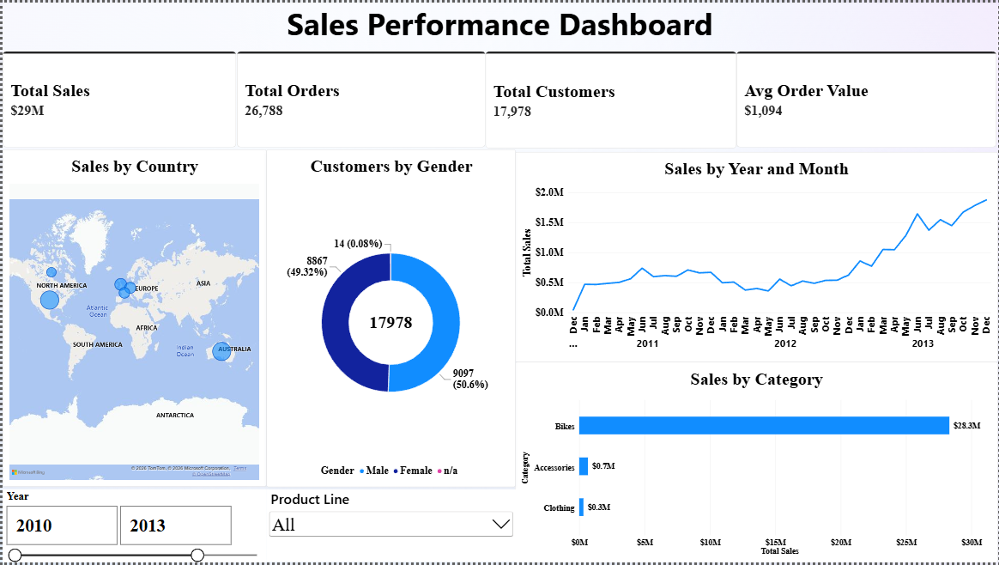

# 🏗️ Data Warehouse and Analytics Project

This portfolio project demonstrates an end-to-end **data warehousing + analytics** workflow: starting from raw CSV extracts (ERP + CRM), building a **SQL Server** data warehouse using the **Medallion Architecture (Bronze/Silver/Gold)**, and finishing with a **Power BI** dashboard on the analytics-ready Gold layer.

- 🗄️ **Database:** `DataWarehouse`
- 🧱 **Schemas:** `bronze`, `silver`, `gold`
- 🛠️ **Tooling:** SQL Server Management Studio (SSMS), Power BI Desktop

---

## Dashboard Preview



Through 2013, sales total **$29.3M** across **26.8K orders** from **18K customers**. Bikes account for **96.6%** of revenue, and monthly sales grew steadily to about **$1.9M** by December 2013. More details are in the [Power BI Dashboard](#power-bi-dashboard) section.

---

## Quickstart (Run Order in SSMS)

1. 🧰 Run `scripts/init_database.sql` *(creates/initializes `DataWarehouse` and the three schemas)*
2. 🥉 Run `scripts/bronze/ddl_bronze.sql` *(creates the bronze tables)*
3. 🥉 Update the CSV file paths in `scripts/bronze/load_bronze.sql`, run it *(creates the load procedure)*, then execute:
   ```sql
   EXEC bronze.load_bronze;
   ```
4. 🥈 Run `scripts/silver/ddl_silver.sql` *(creates the silver tables)*
5. 🥈 Run `scripts/silver/load_silver.sql` *(creates the load procedure)*, then execute:
   ```sql
   EXEC silver.load_silver;
   ```
6. 🥇 Run `scripts/gold/ddl_gold.sql` *(creates the gold views)*
7. ✅ *(Optional)* Run tests:
   - 🥈 `tests/quality_checks_silver.sql`
   - 🥇 `tests/quality_checks_gold.sql`
8. 📊 *(Optional)* Open `powerbi/Sales_Performance_Dashboard.pbix`, point it at your SQL Server instance, and refresh.

---

## Table of Contents

- [Overview](#overview)
- [Data Architecture](#data-architecture)
- [Repository Structure](#repository-structure)
- [Data Sources](#data-sources)
- [How to Run](#how-to-run)
- [Schemas and Layers](#schemas-and-layers)
- [Data Quality Checks and Decisions](#data-quality-checks-and-decisions)
- [Documentation](#documentation)
- [Power BI Dashboard](#power-bi-dashboard)
- [Known Limitations](#known-limitations)
- [License](#license)
- [Author](#author)

---

## Overview

This project includes:

- 🏛️ **Data Architecture** using Medallion layers (**Bronze**, **Silver**, **Gold**)
- 🔁 **ETL Pipelines** to ingest and transform raw CSV data into a structured warehouse, using stored procedures with load timing and error handling
- ⭐ **Data Modeling** with an analytics-friendly **Star Schema** (two dimensions and one fact, exposed as views)
- 📊 **Analytics & Reporting** with a **Power BI** dashboard built on the Gold views

Skills demonstrated:

- 🧠 SQL Development
- 🏗️ Data Engineering & ETL
- 🧩 Dimensional Modeling (Fact & Dimension design)
- 🧪 Data Quality / Testing
- 📈 Data Visualization (Power BI, DAX)

---

## Data Architecture

The warehouse follows the **Medallion Architecture**:

- 🥉 **Bronze Layer (Raw)**
  - Stores source data as-is
  - Data is ingested from CSV files into SQL Server with `BULK INSERT`

- 🥈 **Silver Layer (Cleaned / Conformed)**
  - Cleanses data and resolves quality issues
  - Standardizes formats and aligns keys between the CRM and ERP sources
  - Prepares integrated data for analytics modeling

- 🥇 **Gold Layer (Business / Analytics)**
  - Houses business-ready, curated views: `gold.dim_customers`, `gold.dim_products`, `gold.fact_sales`
  - Modeled into a **Star Schema** for reporting
  - Optimized for analytical queries

📌 Architecture diagrams are available under `docs/`.

---

## Repository Structure

```
sql-data-warehouse-project/
├── datasets/
│   ├── source_crm/
│   └── source_erp/
├── docs/
│   ├── data_architecture.png
│   ├── data_flow.png
│   ├── data_integration.png
│   ├── data_model.png
│   ├── data_catalog.md
│   └── naming_conventions.md
├── scripts/
│   ├── bronze/
│   │   ├── ddl_bronze.sql
│   │   └── load_bronze.sql
│   ├── silver/
│   │   ├── ddl_silver.sql
│   │   └── load_silver.sql
│   ├── gold/
│   │   └── ddl_gold.sql
│   └── init_database.sql
├── tests/
│   ├── quality_checks_silver.sql
│   └── quality_checks_gold.sql
├── powerbi/
│   ├── screenshots/
│   │   └── sales_performance_dashboard.png
│   ├── Sales_Performance_Dashboard.pbix
│   └── README.md
└── LICENSE
```

---

## Data Sources

This project integrates data from two source systems provided as CSV files:

### 🤝 CRM (`datasets/source_crm/`)
- `cust_info.csv`: customer information
- `prd_info.csv`: product information, including price history
- `sales_details.csv`: sales transactions (order lines)

### 🏢 ERP (`datasets/source_erp/`)
- `CUST_AZ12.csv`: customer birthdate and gender
- `LOC_A101.csv`: customer country
- `PX_CAT_G1V2.csv`: product category, subcategory, and maintenance flag

Bronze row counts after loading: customers 18,493 · products 397 · sales lines 60,398 · ERP customers 18,483 · ERP locations 18,484 · product categories 37.

---

## How to Run

### Prerequisites
- 🖥️ SQL Server instance (local or remote)
- 🧰 **SQL Server Management Studio (SSMS)**
- 📂 Local access to the repo's `datasets/` folder (needed for CSV loads)
- 📊 *(Optional)* **Power BI Desktop** (Windows) to open the dashboard

### Steps

1. 📦 **Clone the repository**

   ```bash
   git clone https://github.com/shamymwamuye/sql-data-warehouse-project.git
   cd sql-data-warehouse-project
   ```

2. 🗄️ **Initialize the database**
   - Open SSMS and connect to your SQL Server instance
   - 🧰 Run `scripts/init_database.sql`
   - ✅ This initializes the database `DataWarehouse` with the `bronze`, `silver`, and `gold` schemas

3. 🥉 **Build and load Bronze (raw layer)**
   - 🏗️ Run `scripts/bronze/ddl_bronze.sql`
   - 📥 Run `scripts/bronze/load_bronze.sql`, then `EXEC bronze.load_bronze;`

4. 🥈 **Build and load Silver (cleaned layer)**
   - 🏗️ Run `scripts/silver/ddl_silver.sql`
   - 🔁 Run `scripts/silver/load_silver.sql`, then `EXEC silver.load_silver;`

5. 🥇 **Build Gold (analytics layer / star schema)**
   - ⭐ Run `scripts/gold/ddl_gold.sql`

> 📝 `BULK INSERT` needs a literal file path. Update the paths in `scripts/bronze/load_bronze.sql` to match your machine's absolute path to the repo's `datasets/` folder, and make sure the SQL Server service account can read that folder.

---

## Schemas and Layers

This warehouse uses separate schemas to keep each layer clean and discoverable:

- 🥉 `bronze.*`
  - Raw ingestion tables (as received from the source files)
  - Minimal/no transformation

- 🥈 `silver.*`
  - Cleaned, standardized, and conformed tables
  - Integrated view of ERP and CRM data

- 🥇 `gold.*`
  - Analytics-ready dimensional model, exposed as views
  - `dim_customers`, `dim_products`, and `fact_sales` for BI/reporting use cases

### Gold data model

```
dim_customers ──┐
 (customer_key) │
                ├──< fact_sales
dim_products ───┘
 (product_key)
```

- **`gold.dim_customers`**: one row per customer, combining CRM data with ERP birthdate, gender, and country.
- **`gold.dim_products`**: one row per product (current version only), combining CRM data with ERP categories.
- **`gold.fact_sales`**: one row per order line, linked to both dimensions through surrogate keys.

Column descriptions are in [`docs/data_catalog.md`](docs/data_catalog.md).

---

## Data Quality Checks and Decisions

🧪 Quality checks are included as SQL scripts:

- 🥈 Silver checks: `tests/quality_checks_silver.sql`
- 🥇 Gold checks: `tests/quality_checks_gold.sql`

Run these in SSMS after each layer load to validate cleanliness, consistency, and model integrity.

### Cleaning decisions in Silver

**CRM**
- **Customers:** removed rows with no customer id, kept only the latest record per customer, trimmed names, and expanded coded values (`M`/`F` to Male/Female, `M`/`S` to Married/Single, missing values to `n/a`).
- **Products:** split the combined product key into a category id and a product key, replaced missing costs with 0, expanded product line codes, and rebuilt each end date as the day before the next version's start date.
- **Sales:** converted `yyyymmdd` numbers to real dates, set invalid order dates to NULL rather than guessing, recalculated sales as quantity × price where sales was missing, non-positive, or inconsistent, and derived price from sales ÷ quantity where price was missing or invalid.

**ERP**
- Aligned customer keys with the CRM (removed the `NAS` prefix and the dash).
- Set birthdates in the future to NULL.
- Standardized gender values and country names, and replaced blanks with `n/a`.

### Modeling decisions in Gold
- Gender uses the CRM value first and falls back to the ERP value only when the CRM has none.
- The product dimension keeps only the current version of each product, so price history lives in Silver but not in Gold.

---

## Documentation

All project documentation and diagrams are located in `docs/`, including:

- `data_architecture.png`: architecture overview
- `data_flow.png`: pipeline flow
- `data_integration.png`: source integration
- `data_model.png`: dimensional model / star schema
- `data_catalog.md`: column descriptions for the Gold views
- `naming_conventions.md`: naming rules used in the warehouse

---

## Power BI Dashboard

### Overview

An interactive Power BI dashboard built on the Gold layer of the SQL Server data warehouse (Import mode, so refresh it after reloading the warehouse).

### Key Performance Indicators

- Total Sales
- Total Orders
- Total Customers
- Average Order Value

### Dashboard Analysis

- Sales performance by country
- Customer distribution by gender
- Monthly and yearly sales trends
- Sales performance by product category

### Key Findings (2010 to 2013)

- Sales total **$29.3M** from **26.8K orders** and **18K customers**.
- **Bikes** generate **96.6%** of revenue.
- Monthly sales grew steadily, reaching about **$1.9M** in December 2013.

### Data Model in Power BI

The three Gold views are loaded as a star schema: `dim_customers` and `dim_products` each connect to `fact_sales` through their surrogate keys. A calendar table is related to `fact_sales[order_date]`.

### Notes on the data

- **The dashboard covers 2010 to 2013.** The source data runs to 28 January 2014, but bike sales stop on 28 December 2013 while accessories and clothing continue, so including January 2014 would show a misleading collapse in sales.
- **2010 is effectively one week of data.** The first order is dated 29 December 2010, so the trend line starts near zero.
- **A small number of sales have no order date** (15 orders, about $5K). They are included in the overall data but cannot appear on a date axis.
- **Calendar relationship lesson.** An earlier version linked the calendar table to `due_date`, which pushed late-December orders into the next year and made the dashboard disagree with SQL. Switching the active relationship to `order_date` fixed it. Every headline number was then cross-checked against SQL queries on the Gold views.

### Tools Used

- Microsoft SQL Server
- Power BI Desktop
- DAX
- Power Query

### Project Files

[View the Power BI Dashboard file](powerbi/Sales_Performance_Dashboard.pbix)

---

## Known Limitations

- Product line codes (`M`, `R`, `S`, `T`) were mapped to Mountain, Road, Other Sales, and Touring based on common usage and should be confirmed with the source system owner.
- Where sales, quantity, and price disagreed, quantity and price were treated as correct and sales was recalculated.
- 337 customers have no known country.
- Every run reloads all data. Incremental loading is a possible next step.

---

## License

📜 This project is licensed under the **MIT License**. You are free to use, modify, and share it with proper attribution.

---

## Author

**Shamy Mwamuye**: [github.com/shamymwamuye](https://github.com/shamymwamuye)
