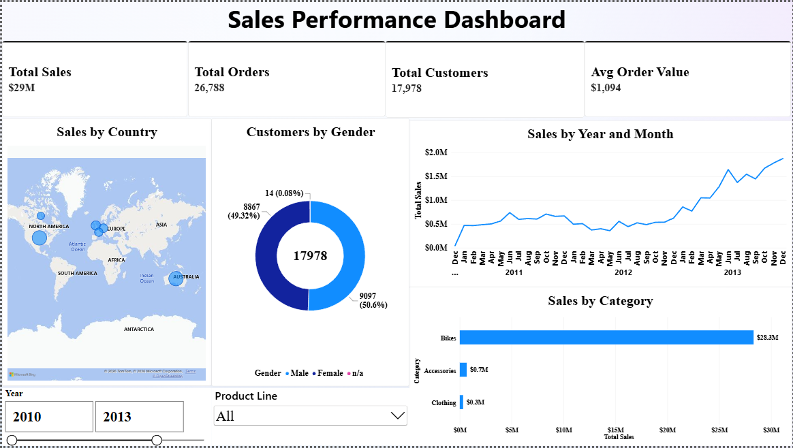

# Power BI – Sales Performance Dashboard

## Project Overview

This project extends the SQL Server Data Warehouse by developing an interactive Power BI dashboard using data from the Gold layer.

The dashboard provides business insights into sales performance, customer distribution, product categories, and sales trends over time. For the warehouse itself (Bronze, Silver, and Gold layers), see the [main project README](../README.md).

## Dashboard Preview



## Key Findings (2010 to 2013)

- Sales total **$29.3M** from **26.8K orders** and **18K customers**, with an average order value of about **$1,094**.
- **Bikes** generate **96.6%** of revenue. Accessories and Clothing together account for the remaining 3.4%.
- Monthly sales grew steadily, reaching about **$1.9M** in December 2013.
- Customers are split almost evenly by gender (about 50.6% male and 49.3% female), with a very small share (0.08%) whose gender is unknown.

## Key Performance Indicators (KPIs)

The dashboard presents four key business metrics:

- **Total Sales:** Overall revenue generated.
- **Total Orders:** Total number of distinct orders processed.
- **Total Customers:** Number of distinct customers who placed orders.
- **Average Order Value:** Average revenue generated per order.

## Dashboard Features

### 1. Sales by Country
Geographical analysis of sales distribution across different countries.

### 2. Customers by Gender
Analysis of customer distribution by gender.

### 3. Sales by Year and Month
Time-series analysis showing monthly sales trends and changes in revenue over time.

### 4. Sales by Category
Comparison of sales performance across product categories, including Bikes, Accessories, and Clothing.

### 5. Interactive Filters
- Year slicer for filtering the reporting period.
- Product Line slicer for analysing specific product lines.

## Data Source

The dashboard uses analytics-ready data from the Gold layer of the SQL Server Data Warehouse developed in this repository. Three views are loaded in Import mode:

- `gold.dim_customers`
- `gold.dim_products`
- `gold.fact_sales`

## Data Model

The views form a star schema in Power BI (shown there with a schema prefix, such as `gold fact_sales`):

- `dim_customers[customer_key]` to `fact_sales[customer_key]` (many to one)
- `dim_products[product_key]` to `fact_sales[product_key]` (many to one)
- A calendar table related to `fact_sales[order_date]` (many to one), used for the Year slicer and the monthly trend

## Measures

The core measures are written in DAX. In Power BI the Gold views appear with their schema as a prefix (for example, `'gold fact_sales'`).

Orders and customers each have **two versions**: a numeric measure (named "... Value") for charts and calculations, and a text measure formatted with thousands separators (for example, `26,786`) used only on the KPI cards. Text measures cannot be used in charts or arithmetic, which is why both exist.

```dax
// Total revenue across all order lines
Total Sales = SUM ( 'gold fact_sales'[sales_amount] )

// Number of distinct orders as a number (one order can have several lines).
// Used in charts and calculations.
Total Orders Value = DISTINCTCOUNT ( 'gold fact_sales'[order_number] )

// Same count formatted as text with thousands separators. Used on the KPI card only.
Total Orders = FORMAT ( DISTINCTCOUNT ( 'gold fact_sales'[order_number] ), "#,##0" )

// Number of distinct customers who bought something, as a number.
// Used in charts and calculations.
Total Customers Value = DISTINCTCOUNT ( 'gold fact_sales'[customer_key] )

// Same count formatted as text with thousands separators. Used on the KPI card only.
Total Customers = FORMAT ( DISTINCTCOUNT ( 'gold fact_sales'[customer_key] ), "#,##0" )

// Average revenue per order. Uses the numeric order count, not the text version.
// DIVIDE avoids a divide-by-zero error.
Avg Order Value = DIVIDE ( [Total Sales], [Total Orders Value] )
```

## Validation Against SQL

The headline numbers were cross-checked against SQL queries run directly on the Gold views (for orders placed before 1 January 2014). The dashboard cards match these values, allowing for rounding where a card uses display units such as "M".

| Measure | SQL result |
|---|---|
| Total Sales | $29,305,616 |
| Total Orders | 26,786 |
| Total Customers | 17,976 |

## Notes on the Data

- **The dashboard covers 2010 to 2013.** The source data runs to 28 January 2014, but bike sales stop on 28 December 2013 while accessories and clothing continue, so including January 2014 would show a misleading collapse in sales.
- **2010 is effectively one week of data.** The first order is dated 29 December 2010, so the trend line starts near zero.
- **A small number of sales have no order date** (15 orders, about $5K). They are part of the warehouse but cannot appear on a date axis.
- **Calendar relationship lesson.** An earlier version linked the calendar table to `due_date`, which pushed late-December orders into the next year and made the dashboard totals disagree with SQL. Switching the active relationship to `order_date` fixed it.

## How to Open and Refresh the Report

1. Build the warehouse first by following the run order in the [main project README](../README.md).
2. Open `Sales_Performance_Dashboard.pbix` in Power BI Desktop (Windows).
3. If the connection fails, go to **Home → Transform data → Data source settings**, change the server to your SQL Server instance, and keep the database as `DataWarehouse`.
4. Click **Refresh**. The report runs in Import mode, so refresh it again whenever the warehouse is reloaded.

## Tools and Technologies

- Microsoft SQL Server
- Power BI Desktop
- Power Query
- DAX (Data Analysis Expressions)
- Data Warehouse: Bronze, Silver and Gold architecture

## Project Objective

To transform structured data warehouse information into interactive visual reports that support business performance monitoring, sales analysis, and data-driven decision-making.

## Possible Next Steps

- Add a second report page for year-over-year growth and top products
- Switch to DirectQuery to compare it with Import mode
- Load data incrementally instead of reloading the whole warehouse

## Project Files

- `Sales_Performance_Dashboard.pbix`: Power BI report file.
- `screenshots/sales_performance_dashboard.png`: Dashboard preview.
- `README.md`: Power BI project documentation.
